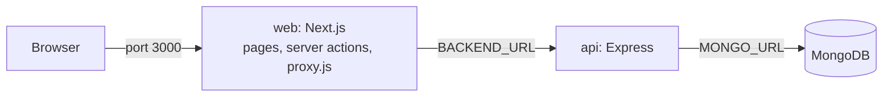

# Expense Tracker


A full-stack expense tracker. Users sign up, log in, and add, edit and delete their own expenses.
Built as a DevOps learning project: containerized with Docker, tested and published by GitHub Actions,
and structured to deploy to managed platforms.

## Features

- Sign up and log in with email and password (passwords hashed with bcrypt)
- Session kept in an `httpOnly` cookie holding a JWT that expires after 7 days
- Dashboard to add, edit, delete and list your own expenses
- Each user can only read and change their own data
- `/dashboard` is protected, and an expired or invalid session sends you back to the login page

## Tech stack

| Part | Technology |
|---|---|
| Frontend | Next.js 16 (App Router, server actions), React 19, TypeScript, Tailwind CSS |
| Backend | Node.js, Express 5, Mongoose 9, JSON Web Tokens, bcryptjs |
| Database | MongoDB 7 |
| Containers | Docker (multi-stage, non-root, health checks), Docker Compose |
| CI/CD | GitHub Actions, GitHub Container Registry (GHCR) |
| Tests and lint | Jest, supertest, ESLint |

## Architecture



- The browser only talks to the Next.js server. Server actions call the Express API, so the API URL
  is a **server-only** variable (`BACKEND_URL`) read at run time, not baked into the build.
- Login stores the JWT in a `session_token` cookie. `frontend/proxy.js` redirects `/dashboard` to the
  login page when the cookie is missing. The real check is in the API, which verifies the JWT on every
  `/api/expense` request.
- When the API answers 401, the frontend redirects to `/logout`, which clears the cookie.

## Quick start with Docker

Requires Docker Desktop (or Docker Engine with the Compose plugin).

1. Create your environment file and set a strong secret:
   ```bash
   cp .env.example .env          # Windows cmd: copy .env.example .env
   node -e "console.log(require('crypto').randomBytes(32).toString('hex'))"
   ```
   Put the generated value in `.env` as `JWT_SECRET=...`. Never commit `.env`.
2. Start everything:
   ```bash
   docker compose up --build
   ```
3. Open http://localhost:3000

| Command | What it does |
|---|---|
| `docker compose up -d --build` | Rebuild and start in the background |
| `docker compose ps` | Show service status and health |
| `docker compose logs -f api` | Follow the API logs |
| `docker compose down` | Stop and remove containers, **keep** the database volume |
| `docker compose down -v` | Also **delete** the database volume (all data) |

Compose starts `mongo`, waits until it is healthy, then starts `api`, waits until it is healthy,
then starts `web`. Only `web` publishes a port.

## Run without Docker

Requires Node.js 22 or 24 and a local MongoDB.

```bash
# Backend
cd Backend
cp .env.example .env          # set MONGO_URL and JWT_SECRET
npm install
npm run dev                   # http://localhost:5000

# Frontend (second terminal)
cd frontend
cp .env.example .env.local    # set BACKEND_URL=http://localhost:5000
npm install
npm run dev                   # http://localhost:3000
```

## Environment variables

| Variable | Used by | Description |
|---|---|---|
| `JWT_SECRET` | root `.env` (Compose) and `Backend/.env` | Secret used to sign login tokens. Use a long random value |
| `MONGO_URL` | `Backend/.env` | MongoDB connection string. Compose sets it to the `mongo` service |
| `PORT` | `Backend/.env` | API port, defaults to `5000` |
| `BACKEND_URL` | `frontend/.env.local` | URL of the API, read by the Next.js server at run time. Compose sets it to `http://api:5000` |

Only the `.env.example` files are committed. Real `.env` files are git-ignored.

## API

All expense routes need the login token in an `Authorization` header (the raw token, no `Bearer` prefix).

| Method | Path | Auth | Description |
|---|---|---|---|
| GET | `/health` | no | Returns `{"status":"ok"}`, used by Docker health checks |
| POST | `/api/auth/signup` | no | Body: `name`, `email`, `password`. 400 for missing fields or a duplicate email |
| POST | `/api/auth/login` | no | Body: `email`, `password`. Returns `{ "token": "..." }` |
| GET | `/api/expense` | yes | List your expenses |
| POST | `/api/expense` | yes | Body: `title`, `amount`, optional `date` |
| PUT | `/api/expense/:id` | yes | Body: `title`, `amount`. Only your own expense |
| DELETE | `/api/expense/:id` | yes | Delete your own expense |

## Testing

```bash
cd Backend
npm test        # Jest and supertest: health, signup validation, auth middleware
npm run lint    # ESLint

cd ../frontend
npm run lint
npm run build
```

The backend tests do not need a database. `Backend/app.js` builds and exports the Express app and
`Backend/server.js` connects to MongoDB and listens, so tests can import the app without starting a server.

## CI/CD

Workflow: [`.github/workflows/ci.yml`](.github/workflows/ci.yml)

| Job | Runs on | What it does |
|---|---|---|
| Backend | pull requests and `main` | Lint and tests on Node 22 and 24 |
| Frontend | pull requests and `main` | Lint and production build |
| Docker images build | after Backend and Frontend pass | Builds both images without publishing |
| Publish | pushes to `main` only, after all of the above | Pushes both images to GHCR |

Published images:

```
ghcr.io/shaunak0423/expense-teacker-backend
ghcr.io/shaunak0423/expense-teacker-frontend
```

Each build is tagged `:sha-<commit>` (immutable, use this for deploys and rollbacks) and `:latest`
(moves with every build, for convenience only). To roll back, deploy an earlier `sha-` tag.

`main` is protected: changes go in through a pull request, and the checks above must pass.

## Docker details

- **Backend image:** `node:24-alpine`, production dependencies only, runs as the non-root `node` user,
  health check on `/health`.
- **Frontend image:** multi-stage build. Stage 1 installs and builds, stage 2 contains only the
  Next.js standalone output and runs as `node`. Health check on `/`.
- **`.dockerignore` files** keep `node_modules`, `.env` files and tests out of the images.
- **Database data** lives in the named volume `mongo-data`, so it survives `docker compose down`.

## Project structure

```
.
├── Backend/                 Express API
│   ├── app.js               builds the Express app (exported for tests)
│   ├── server.js            connects to MongoDB and starts listening
│   ├── Routes/              auth and expense routes
│   ├── Middleware/          JWT check
│   ├── Models/              User and Expense schemas
│   ├── tests/               Jest tests
│   └── Dockerfile
├── frontend/                Next.js app
│   ├── app/                 pages, server actions, /logout route
│   ├── Components/
│   ├── proxy.js             redirects /dashboard when there is no session cookie
│   └── Dockerfile
├── compose.yaml             frontend, backend and MongoDB
└── .github/workflows/ci.yml
```

## Security notes and known limitations

- Password reset is not available. The earlier route let anyone reset any account's password, so it was
  removed. A safe version needs an emailed, expiring token.
- CORS currently allows every origin. Restrict it to the frontend's domain before a public deployment.
- Login returns different messages for an unknown user and a wrong password, and there is no rate limiting.
- The API is not exposed outside the Compose network, and MongoDB runs without authentication locally only.
  A hosted database must use credentials.

## Roadmap

- [x] Docker and Docker Compose
- [x] CI with GitHub Actions and image publishing to GHCR
- [ ] MongoDB Atlas
- [ ] Deploy the API on Railway
- [ ] Deploy the frontend on Vercel
- [ ] Dependabot, `npm audit` in CI, uptime monitoring
- [ ] Token-based password reset
